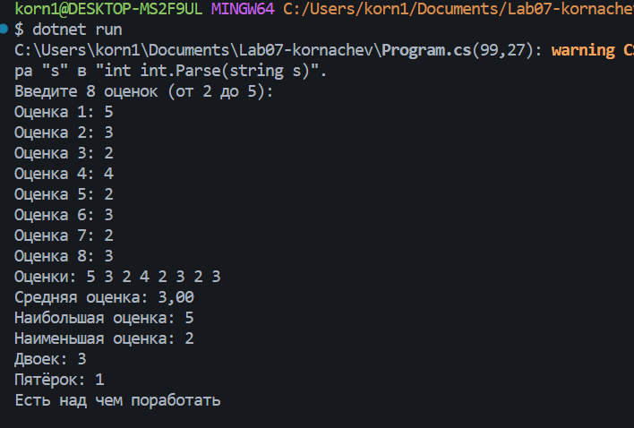
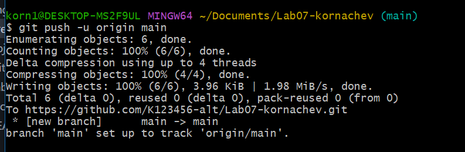

# Практическая работа №7

**Корначев Кирилл Александрович**
**Группа - ИСП-243**
**Дата: 13.10.2026**

## Что изучено
- хранить набор однотипных значений в одном массиве;
- получать и изменять элементы по индексу;
- перебирать массив черезfor и foreach;
- решать типовые задачи: сумма, среднее, минимум/максимум, подсчёт по
условию.

